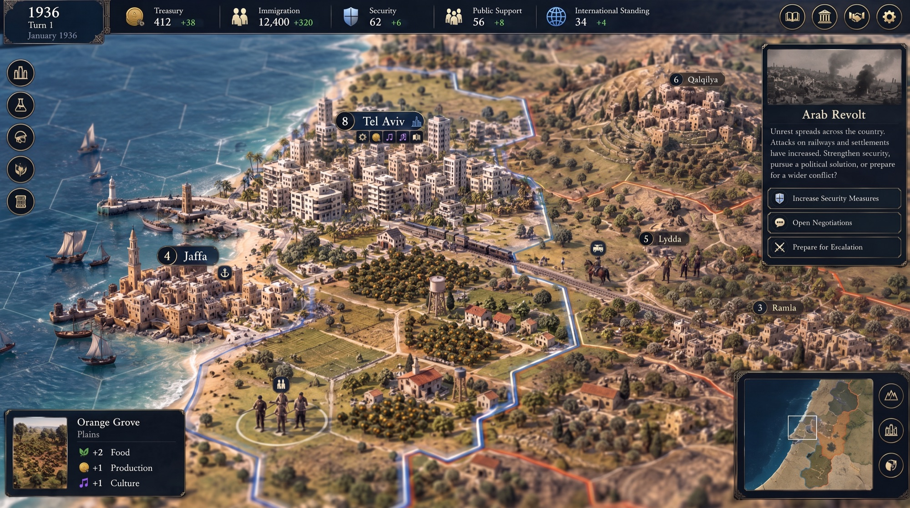
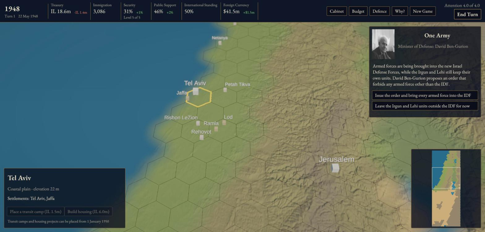
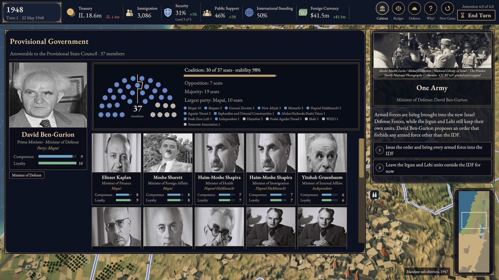
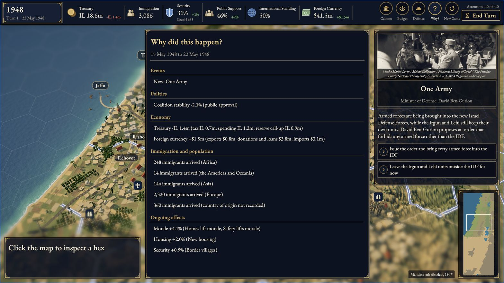

[English](README.md) · **עברית**

# Statecraft: Israel

*אמנות קונספט שנוצרה בבינה מלאכותית: המראה שאליו אנחנו שואפים, בשנת 1936, לפני נקודת הפתיחה של המשחק ב־1948. זו אינה הגרסה הנוכחית, והיא מציגה דברים שאין עדיין במשחק. צילומי מסך אמיתיים מהגרסה הנוכחית מופיעים למטה.*

**משחק אסטרטגיה מבוסס־תורות על ניהול מדינת ישראל. אתם ראש הממשלה ב־15 במאי 1948. השרים אמיתיים, המפה אמיתית, ולכל עובדה היסטורית יש מקור.**

העמוד הזה תמצית של [README.md](README.md). הנוסח האנגלי הוא המחייב, ואם יש הבדל בין השניים, האנגלי קובע. תיקוני לשון לעמוד הזה יתקבלו בברכה.

 

<em>צילומי מסך אמיתיים מגרסה 0.1.0 (M3), 2026-10-10.</em>

> [!NOTE]
> 
Statecraft: Israel הוא פרויקט קוד פתוח עצמאי, ומתוכננת לו גרסה מסחרית. אין לפרויקט קשר ל־Firaxis, ל־2K, למדינת ישראל או לאדם כלשהו המופיע בו, והם אינם תומכים בו. המשחק עוסק במלחמה, בטרור ובשואה כאירועים היסטוריים. המסגור שלו ישראלי, כל עובדה מצוטטת עם מקור, ואף ציטוט אינו בדוי. לפרטים: <a href="docs/CONTENT_POLICY.md">מדיניות התוכן ההיסטורי</a>.

##### [דיווח על באג](https://github.com/eyalgolan/statecraft-israel/issues/new?template=bug_report.yml) | [דיווח על טעות היסטורית](https://github.com/eyalgolan/statecraft-israel/issues/new?template=historical_accuracy.yml) | [דיונים](https://github.com/eyalgolan/statecraft-israel/discussions) | [יומן שינויים](CHANGELOG.md)

## על מה המשחק?

אתם יושבים בכיסא ראש הממשלה מיום הקמת המדינה. בכל תור אתם ממנים ומחליפים שרים אמיתיים בתוך קואליציה אמיתית, מחלקים תקציב זעום, מנהלים את הביטחון על סולם הסלמה, ומכריעים בהחלטות אמיתיות במועדן האמיתי. מתחת לפני השטח רצה סימולציה דטרמיניסטית ב־C#: אותן בחירות תמיד נותנות אותה תוצאה. המפה נבנתה מנתוני גובה ואקלים אמיתיים.

## מה המצב היום?

***אב־טיפוס מוקדם: אבן הדרך M3 הושלמה, והשנים 1948 עד 1951 ניתנות למשחק כשבונים מקוד המקור.*** עדיין אין גרסה שאפשר לשחק בה בדפדפן בלחיצה אחת; גרסה מתארחת מתוכננת לאבן הדרך M4. הוראות ההרצה המקומית (באנגלית): [BUILDING.md](BUILDING.md). הבנייה דורשת Unity בגרסה 6000.3.25f1.

## היסטוריה, מקורות ודיוק

- לכל אירוע, שר, תאריך ומספר יש מקורות ותאריך בדיקה. ויקיפדיה (באנגלית ובעברית) היא מקור מצוטט מרכזי לעובדות רבות, ולכן תוכן המשחק (`content/`) מורשה ב־CC BY-SA 4.0.
- המודל שמאחורי המשחק והמסגור שלו מבוססים על הנחות. הוא אינו ניטרלי, והעמוד הזה אומר זאת במפורש.
- אף ציטוט לא מיוחס לאדם אמיתי אלא אם הוא מתועד מילה במילה.
- אירועים על מלחמה, טרור ושואה מסומנים כרגישים. הם עוברים בדיקת רגישות לפני שמשתפים גרסה כלשהי, וכלי הבנייה מסרבים לארוז עד שהבדיקה נרשמה. סקירה של היסטוריונים מתוכננת לאבן הדרך M4.
- מצאתם טעות? מלאו את טופס [טעות היסטורית](.github/ISSUE_TEMPLATE/historical_accuracy.yml) וצרפו מקור, כי אי אפשר לפעול על טענה בלי מקור. הכללים המלאים: [docs/CONTENT_POLICY.md](docs/CONTENT_POLICY.md).

## איך משתתפים

מתכנתים, היסטוריונים, אמנים, מעצבי משחק, כותבים ומתרגמים: התחילו ב־[CONTRIBUTING.md](CONTRIBUTING.md) (באנגלית). אפשר לעבוד גם עם בינה מלאכותית, בתנאי שמצהירים על כך ושכל טענה היסטורית נבדקה מול מקור. אין הסכם CLA: תרומות נכנסות תחת הרישיונות של המאגר. מחפשים משימה ראשונה? ראו את הסינון [good first issue](https://github.com/eyalgolan/statecraft-israel/labels/good%20first%20issue), את [help wanted](https://github.com/eyalgolan/statecraft-israel/labels/help%20wanted) ואת [הבעיות הפתוחות](https://github.com/eyalgolan/statecraft-israel/issues).

## שימוש בבינה מלאכותית

הפרויקט נבנה בסיוע מאסיבי של בינה מלאכותית. קוד נכתב עם סוכני קוד ונבדק בבדיקות ובשערי סקירה; תמונות הקונספט והפרומו הן תוצר של בינה מלאכותית, וטקסט האירועים נוסח בסיועה וכל עובדה בו נבדקת מול המקור המצוטט. הפורטרטים הם צילומים בנחלת הכלל, ואין עדיין סאונד. דבר אינו נוצר בזמן אמת בזמן המשחק.

## רישיון

קוד: MIT. תוכן המשחק (`content/`): CC BY-SA 4.0. מסמכים, נתונים ואמנות מקוריים: CC BY 4.0. תמונות שנוצרו בבינה מלאכותית: CC0, ללא טענת זכויות. הפירוט: [LICENSING.md](LICENSING.md).

על בעיות אבטחה מדווחים באופן פרטי, ראו [SECURITY.md](SECURITY.md). קוד ההתנהגות: [CODE_OF_CONDUCT.md](CODE_OF_CONDUCT.md).

