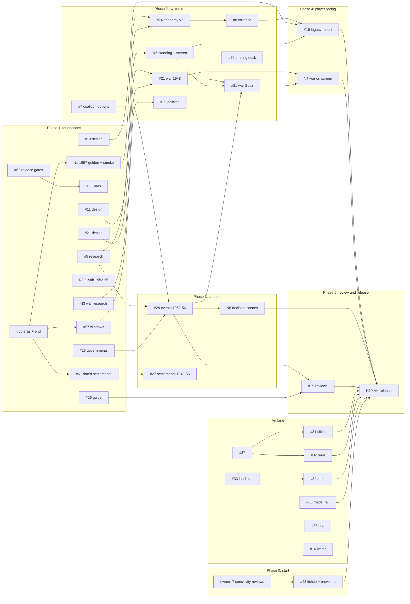

# Statecraft: Israel: M4 plan (the full 1948–56 slice)

- **Date:** 2026-10-10
- **Status: PROPOSED — owner review needed for the decisions in "Owner decisions"**
- **Issue:** #48 (roadmap tracker). Every work item below is an existing issue or a new issue drafted in
  "New issues"; this plan adds no other work.
- **Spec:** [2026-10-09-statecraft-israel-design.md](../specs/2026-10-09-statecraft-israel-design.md) §9: M4 is "All
  slice content, war mode (1948 and Suez), the legacy report and historian review"; M5 is "Polish and Steam page".
- **Builds on:** [the chapters design](../specs/2026-10-10-chapters-architecture-design.md) (#53; the founding era is
  15 May 1948 to 1 January 1957, decision D3; items #56–#67) and, for boundary rules only,
  [the Yishuv design](../specs/2026-10-10-era-yishuv-design.md) (#49).
- **Format:** this is an ordering plan, like the "Parallel tracks" table of the
  [M3 plan](2026-10-10-statecraft-m3.md). It sets the order, the gates and the scope line. Each issue gets its own
  task-level plan (code, tests, observed totals) when someone picks it up. Sizes are effort, not dates: **S** one small
  PR; **M** one PR across a few files with tests; **L** several PRs, or one large one; **XL** a design plus several PRs
  across the sim and Unity.

## What exists today (checked against `main`, 2026-10-10)

| Area | Today | M4 gap |
|---|---|---|
| Play range | 15 May 1948 onward; content ends 31 Dec 1951; no end date (`GoldenRun` stops at 1000 turns) | No 1952–56 content; no end of the game (#56) |
| Content | 31 events (1948–51), 4 policies, 4 voter groups, 13 actors with a starting standing (not in state), 25 settlements, governments to the Third Government, the Second Knesset, aliyah and population to 1951 | 1952–56 everything; aliyah 1952–56 has no issue |
| Sim | Effects web, politics and coalition collapse, Cabinet and Appoint, budget and economy (calibrated 1950–51), population, events with `requires`, security ladder with a ceasefire clock, map actions (transit camp, housing), saves, release gate for sensitive events | No war mode, no collapse of the state (#8), no actor standing, `Mode.Open` throws, minister loyalty unused |
| Unity | HUD, Cabinet, Budget, Defence, Event card, Why panel, info panel, minimap, labels, New Game and autosave, golden and smoke checks in the player | No legacy report, Diplomacy screen, briefing desk, decision scenes or war map |
| Look | Visual v1 shipped (`docs/visual-v1.md`): light, tilt-shift, terrain, sea, grid, labels, tiers | Placeholder settlement markers; no kits, vegetation, land use, roads or rail |
| Goldens | `Hash1950` (turn 35, 27 Feb 1950), `Hash1952` (turn 43, 27 Feb 1952), `SMOKE OK 5 turns` | No golden past February 1952; `SliceSmokeTests` stops at 1 Jan 1952 |
| Release | Local Brotli build; itch.io upload and the two-upload save test deferred to the start of M4 (`docs/m3-release.md`) | #43 |

## M4 is done when

All of the following hold on one merge candidate. Items marked *(owner)* need the owner; everything else is checked by a
test or a script.

1. **Playable end to end in the browser.** A new Historical game runs from 15 May 1948 to 1 January 1957 in the WebGL
   build. On 1 January 1957 the game ends with the legacy report (#56, #19). A game can also end early, by coalition
   collapse (exists) or by military or economic collapse (#8), and then shows the same report.
2. **The slice's content.**
   - Governments, ministers and the Third Knesset with the 1955 results (#26); immigration and population 1952–56 (new
     N2).
   - About 40 events across 1948–56 (31 exist), covering every spec anchor: the reparations vote (January 1952), the
     agreement (10 Sep 1952, in force 27 Mar 1953), the New Economic Policy (February 1952), the 1955 election
     (26 Jul 1955), the Czech–Egyptian arms deal (27 Sep 1955) and Suez (1956) (#5, #28).
   - About six full decision scenes (new N6).
   - Policies and voter groups to the M4 target in D2 (#25).
   - Settlements founded 1949–56 appear on their dates (#61, #27); the 1949 armistice lines are drawn by date (#63).
   - Every fact sourced with a check date; every event at least `fact-checked`; every sensitive event
     `sensitivity-reviewed` *(owner)*.
3. **War mode for 1948 and Suez** on the hex map at rung 5: operational campaigns, no tactical combat, outcomes from force
   balance, intelligence, doctrine and morale, limited by superpower pressure and the UN ceasefire clock (#21 sim, N4 on
   screen, N5 for the pressure). Deterministic, explained in the Why panel, and no option rewards an atrocity.
4. **The economy recovers** after 1952 as the sources say (#24), and the historical run reaches 1 January 1957 without
   collapsing (N1's test).
5. **Politics and diplomacy.** Event options can move coalition stability and support (#7); the briefing desk shows at
   most five items a turn (#20); actors have standing in the sim and a Diplomacy screen shows it (N5, scope in D3).
6. **Historian review** to the bar in D5 (#29) *(owner names the reviewers)*.
7. **The art minimum** in D6: city and rural kits, land use, citrus and olive trees, roads and the railway, 1948 water,
   markers on the ground, the sea toned (#31–#35, #37, #38, #16), with the measured bars below and the owner's verdict
   on the gameplay03 side-by-side *(owner)*.
8. **Verification.** `dotnet test sim/Statecraft.sln`, `tools/tests` and the Unity EditMode suite pass; the goldens follow
   the policy below, including a new 1957 golden; `SliceSmokeTests` play the full slice; the Brotli WebGL build passes
   `tools/web_check.py` with every `GOLDEN OK` line and the full-slice smoke; the frame-time and boot budgets of
   `docs/visual-v1.md` hold; Firefox, Safari and Windows are checked (#43); the shareable build passes the release gate
   (#62); `uv run scripts/oss/check_repo.py` passes.
9. **Shipped** to the project's itch.io page as the owner chooses (Restricted or Public) *(owner)*, recorded in a new
   `docs/m4-release.md` (N10).

### In M4, if ready, or later

These carry the M4 label but do not block M4 (D1). Each may land during M4 if its design is agreed and it passes the
same gates; otherwise it moves to the next plan with its issue unchanged.

| Issue | Why it does not block M4 |
|---|---|
| #10 Open mode | Every anchor becomes conditional, which multiplies the test matrix; Suez in Open mode needs war mode and diplomacy first. M4 ships Historical mode |
| #9 Bills voted by the parties | The slice's votes (the reparations vote, the Law of Return) already work as events; bills are a new system that no M4 anchor needs |
| #22 Defence depth | War mode (#21) defines the minimum of command, intelligence and forces it needs; the full Defence system (procurement, manpower policy) is depth, not slice content |
| #23 Map actions beyond absorption | Historical settlements appear from data (#27, #61); player-built towns and kibbutzim are depth |
| N7 Delegation by loyalty, N8 dated budget lines | M3 Deferred correctness rows; both move the goldens and add no slice content |

### M5, and what may run in parallel with M4

M5 is polish and the Steam page. Items that touch neither `sim/` nor `content/` cannot move a golden, so they may run
at any time during M4 without blocking it or being blocked:

- **Any time:** #47 (favicon), #39 (audio), #40 (settings), #41 (accessibility), #42 (onboarding), #45 (the AI
  disclosure generator and the store checklist; the trailer waits for the art), #36 (border skirt and the table/frame of
  promo 02), #6 and #30 (portraits; #30 must land before any commercial build), #1, #12.
- **After M4:** #54 (desktop and Steam), new N9 (shareable builds need `historian-reviewed` content), save export and
  import if #43's save test fails, the train and boats moving along #35's routes, screen-by-screen comparison
  (spec §8.5), the smaller download.
- **Other tracks, not M4:** the Yishuv chapters (#49, #80–#99), the chapters items they need (#58, #59, #60) and the
  deferred ones (#64–#67), later eras (#50–#52), Hebrew (#55). Their boundary rules are under "Rules shared with the
  Yishuv track".

## Owner decisions

Each has a recommended default; the plan proceeds with the default until the owner rules.

| # | Decision | Recommended default |
|---|---|---|
| D1 | The scope line | **As above:** #10, #9, #22, #23, N7 and N8 are "if ready" and do not block M4. Everything in "M4 is done when" does |
| D2 | The slice content budget (spec §4: about 40 events, about 6 decision scenes, about 60 policies, about 15 voter groups) | **Events and scenes as the spec says. Policies about 20 and voter groups about 8 for M4**, the rest later. Each policy needs a sourced historical basis and calibration, and a policy no test calibrates is noise in the effects web |
| D3 | Diplomacy in M4 | **Actor standing in the sim, moved by events, war and policies, read by war mode and the legacy report, and shown on a read-only Diplomacy screen.** Player diplomatic actions and treaties come later, after #11's design |
| D4 | War mode and the 1948 goldens | **War mode replaces how the 1948 operations resolve, and `Hash1950`, `Hash1952` and the smoke line are rebaselined once, in the commit that lands it**, with a history row. The alternative, keeping 1948 as events and using war mode only for Suez, misses spec §9 |
| D5 | The historian-review bar for M4 | **The review guide merged, at least one named reviewer, and recorded reviews for at least the war events (1948 operations and Suez) and the 1952–56 decision scenes.** Requiring every event to be `historian-reviewed` in shareable builds is N9, in M5, because it depends on volunteers outside the project |
| D6 | The art bar for M4 | **#31, #32, #33, #34, #35 (static roads and rail), #37, #38 and #16 are M4; #36, the moving train and boats, and #39 are M5.** M4 art is done when the measured bars below hold and the owner says the gameplay03 side-by-side reads as promo 03 |
| D7 | The 1957 golden | **Pinned early (N1, end of Phase 1) and moved on purpose by every 1952–56 content PR**, each with a history row; frozen at the M4 merge candidate. Pinning only at the end would leave the 1952–56 work with no determinism check |

The chapters design's decisions D1–D6 are separate; M4 needs only its D3 (the founding era's dates), already used here.

## Phases and dependencies

Lanes run in parallel; arrows are hard dependencies. **Critical path** is in bold in the tables. Two chains decide
when M4 can finish:

- **War chain (the longest):** N3 research → #21 design → #21 sim, 1948 → N5 standing → #21 sim, Suez (with #5's Suez
  note and #28's road-to-Suez events) → N4 on screen → N10.
- **End-of-game chain:** #56 → N1 → #24 → #8 → #19 → N10.

Content (#5 → #26 → #28 → N6) and art (#31–#35) are long but parallel; they join at N10.

### Phase 0: start of M4 (owner first)

| Item | Size | Needs | Notes |
|---|---|---|---|
| Owner rules on D1–D7 | — | this plan | Until then the defaults apply |
| Owner sensitivity review of the seven events in `docs/m3-release.md` | S *(owner)* | — | Required before any build leaves the machine, the itch.io Draft included (`-shareable`) |
| #43 itch.io private Draft, the two-upload save test, Firefox, Safari, Windows | M *(owner uploads)* | the review above | The owner ruling put this at the start of M4. If the save does not survive a re-upload, save export and import moves from M5 into M4 |
| #47 favicon | S | — | good first issue |

### Phase 1: foundations (all lanes in parallel)

| Lane | Item | Size | Needs | Notes |
|---|---|---|---|---|
| Chapters | **#56 `eras.yaml`, the era lookup, the end at 1 Jan 1957** | S–M | chapters D3 | Golden-safe (its done-when). Until #19 exists the end sets `GameOver` with a reason |
| Chapters | #57 dated windows for model records and offices | M–L | #56 | Makes a 1952–56 policy or voter group golden-safe: without it every new `model.yaml` record moves both goldens (chapters design §2) |
| Chapters | #61 one dated `settlements.yaml` | M | #56 | Agrees #27's file shape; the kits (#31, #32) read it |
| Chapters | #62 release gates for living people and sensitive map rows | S–M | — | Needed before #27 adds `until` rows or renames, and before #63 |
| Chapters | #63 dated lines (`lines.yaml`, the 1949 armistice lines) | M | #62 | Every entry needs the owner's sensitivity review before a shareable build |
| Goldens | **N1 the 1957 golden and the full-slice smoke** | S–M | #56 | Pins `Hash1957` (D7); `SliceSmokeTests` to 1 Jan 1957; a full-slice smoke in the browser |
| Research | **#5 research notes 1952–56** | L | — | Split by event; the NEP note first (it feeds #24), then reparations, the 1955 election, the arms deal, the road to Suez. The notes also decide which 1953–56 border events appear (see Risks) |
| Research | #26 governments, ministers, the Third Knesset | M | — | Content with loader tests; lands as soon as it is sourced. #2 and #4 touch the same files: land them first or in the same PR series |
| Research | N2 immigration and population 1952–56 | S–M | — | CBS series, as M3 Task 3 did for 1950–51 |
| Research | #24 step 1: the 1952–56 annual series (CBS, Bank of Israel) | M | — | No code |
| Research | **N3 forces, fronts and operations of 1948 and 1956** | M | — | Feeds #21's design and data |
| Research | #27 settlements founded 1949–56, by region | L | #61's shape | Data lands after #61 |
| Research | #16 note: the 1948 Dead Sea level and the Hula lake and swamp | S | — | The bake change follows in the art lane |
| Research | #3 budget approval 1948–56 | S | — | Open question on the Third Knesset record too |
| Design | **#21 war mode design** (agreed in the issue) | M | — | Must say: fronts on hexes, what a weekly turn resolves, how Yoav, Hiram, Horev and Kadesh fit as anchors, what it reads from N5, and the Why lines. See "Rules shared with the Yishuv track" for the switch |
| Design | #11 diplomacy design, to D3's scope | S–M | — | Standing, what moves it, what reads it, the screen |
| Design | #19 legacy report design | S–M | — | The six scores, each from existing state; the "what happened" side from the historical run, using the same reference-file mechanism as #59 (`carry/<era>.reference.yaml`, written by a tool from `GoldenRun`) so the two never disagree |
| Design | #8 collapse thresholds and grace periods | S | — | Must leave the historical run alive to 1957 |
| Design | #20 briefing ranking proposal; N6 decision-scene proposal | S each | — | |
| Review | #29 the review guide (`docs/HISTORIAN_REVIEW.md`) and the first reviewer | S *(owner finds reviewers)* | — | Start the 1948–51 events now; they do not change in M4 |
| Art | #37 markers on the ground (shadow bias) | S | — | First, so every later art checkpoint judges grounded objects |
| Art | #38 sea and gold-hills saturation | S–M | — | Before the kits, so their colour is judged against the final sea |
| Art | #31 and #32 style tests (one archetype each) and reference photos | M | — | Public-domain or CC0 references; not the GPO collection (#30) |
| Art | #33 land-use data proposal; #35 route research | M each | — | Both are sourced data first |

### Phase 2: sim systems

| Item | Size | Needs | Notes |
|---|---|---|---|
| **#24 economy calibration v2 and the NEP** | L | #5 NEP note, #24 step 1, N1 | Prefer parameters that act from 1952 (dated or era-keyed) so `Hash1950`/`Hash1952` stay; if a 1948 parameter must move, say so and rebaseline (policy below) |
| **#8 military or economic collapse** | M | #24, #8 design | N1's test "the historical run reaches 1 January 1957 alive" must pass with it on |
| #7 event options move coalition stability and support | S–M | — | Needed by #28's coalition crises; the 1951 education crisis is its first real use |
| **N5 actor standing in the sim and the Diplomacy screen** | M–L | #11 design | Standing in `GameState` is hashed only when it differs from the content default, so the goldens move only where events move it |
| **#21 war mode sim, 1948** | XL | #21 design, N3 | One deliberate rebaseline of all three 1948 values (D4). The 1948 operation events stay the anchors |
| **#21 war mode sim, Suez** | L | 1948 part, N5, #5 Suez note, #28 road-to-Suez events, #26 (Dayan as Chief of Staff) | Moves only `Hash1957` |
| #25 policies and voter groups, to D2 | M per batch | #57 | Records dated from 1952 are golden-safe through #57; ones active from 1948 move both goldens |
| #20 briefing desk (sim ranking, then the desk UI) | M | proposal | Read-only: goldens unchanged |
| #61 then #27 data | L | #61, research | Goldens unchanged (#61's done-when); `settlement_hexes.yaml` rebuilt |

### Phase 3: content 1952–56

| Item | Size | Needs | Notes |
|---|---|---|---|
| **#28 events 1952–56** | L (one PR per event or small group) | #5, #26, #7 | Only `Hash1957` moves (each PR says so). Sensitive tags get the owner's review before any shared build |
| N6 decision scenes | M (screen) + content | N6 proposal, #28 | Scenes are events with a richer screen; the sim sees an ordinary event |
| N2 immigration rows land | S | N2 research | Moves `Hash1957` only (rows from 1952) |
| #63 lines and #27 settlements reviewed | S *(owner)* | #62 | Sensitivity review of `until` rows, renames and every line |

### Phase 4: player-facing

| Item | Size | Needs | Notes |
|---|---|---|---|
| **#19 legacy report** | L | #19 design, #56, #8, N1, N5 | Sim scores with tests; a UI Toolkit screen; shown at 1 Jan 1957 and on an early end |
| **N4 war mode on screen** | L | #21 sim (both parts) | Fronts and orders on the hex map, unit markers at symbolic scale; no rules in Unity |
| #20 desk UI, N5 screen | M each | their sim parts | |

### Art lane (parallel to Phases 1–4)

| Item | Size | Needs | Notes |
|---|---|---|---|
| #37, #38 | S, S–M | — | Phase 1 |
| #31 city kits (Tel Aviv, Jaffa, Haifa, Jerusalem, Mandate towns) | XL | #37, style test | One archetype per PR; each replaces the markers for that archetype |
| #32 rural kits (kibbutz, moshav, ma'abara, Arab village, Negev outpost) | L | #37, style test | The ma'abara kit shows the player's `transit_camp` |
| #33 land use in the terrain shader | L | land-use data | Edit `tools/terrain_graph.py`, not the graph |
| #34 citrus and olive trees, scrub | M–L | #33 | GPU instancing; draw calls checked with `?vprofile` |
| #35 roads and the railway (static) | L | route data | The moving train and boats are M5 (D6) |
| #16 1948 water bodies | M | #16 note | `tools/terrain_bake.py` reads the data; visual only |

### Phase 5: review and release

| Item | Size | Needs | Notes |
|---|---|---|---|
| #29 reviews to the D5 bar | M *(reviewers)* | guide, #28, #21 | Reviews recorded in the YAML as the guide says |
| Owner sensitivity reviews of every new sensitive event and map row | S–M *(owner)* | #28, #27, #63 | The shareable build refuses until done |
| **N10 the M4 release** | M | everything above | Full-slice WebGL build, all checks, the final art checkpoint, `docs/m4-release.md`, the owner's upload |

## Gates per phase

### Goldens policy

The three places each golden lives (`GoldenRun.cs`, `DeterminismTests.cs`, `docs/determinism.md`) change together, in one
commit, with a history row and the reason in the commit message, as today.

| Golden | Policy in M4 |
|---|---|
| `Hash1950`, `Hash1952` | **Frozen**, except these named, deliberate moves: #21's 1948 war mode (D4, expected); #24 only if a parameter acting before 1952 must change; #25 records active before 1952; #7 if a 1948–51 event uses it; N5 if 1948–51 events move standing; N7 and N8 if they land. Everything else must leave them unchanged, and the chapters items (#56, #57, #61–#63), #19, #20, N4, N6 and every art issue say so in their done-when |
| `Hash1957` (N1) | **Moving** until the M4 merge candidate: every PR with 1952–56 content or rules moves it on purpose and says so. Frozen at N10 |
| `SMOKE OK 5 turns` | Moves only with the UI path or the 1948 rules (#21). The full-slice smoke line (N1) moves with `Hash1957` |

Golden-moving PRs merge one at a time, rebased on each other, so the constants never conflict. A golden that moves
without a stated reason is a determinism bug.

### Tests per phase

| Phase | Sim (`dotnet test`) | Unity EditMode | WebGL (`tools/web_check.py`) |
|---|---|---|---|
| 0 | — | — | #43's browser results recorded in `docs/m3-release.md` |
| 1 | Each chapters item's fixture tests; `SliceSmokeTests` to 1957 (N1); content loader tests for #26 and N2 | `SimSmokeTests` prints a `GOLDEN OK` line per pinned run, 1957 included | `--expect` gains `GOLDEN OK 1957`; the full-slice smoke plays to the end |
| 2 | Per-system unit tests; collapse never fires on the historical run; war mode determinism across cultures (`CultureTests` pattern); `HistoricalAI` issues the historical war orders | Screens added in this phase pass `UiLayoutTests` at 1280×720 | Both goldens and the smoke after each golden-moving PR |
| 3 | Content tests: sources, `{office}` placeholders resolve on the event's date, no invented quotes, no reward on sensitive options, `requires` only backwards | `PlayerTextTests`-style guards on new screens (no ids, dates as "15 May 1948") | Full-slice smoke still passes |
| 4 | Legacy scores deterministic, computed in the sim, one test per score | The legacy report, the war map, the desk and the Diplomacy screen pressed with `NavigationSubmitEvent`, not `ClickEvent` | Full-slice smoke ends on the legacy report |
| 5 | Release gate (`Statecraft.Cli --release-gate`) passes on the shareable content | Whole suite, `-buildTarget OSXUniversal` | Brotli build: every `GOLDEN OK`, full smoke, budgets, file count under itch.io's 1,000 |

Every Unity run follows the visual plan's rules: edit-mode under `tools/machine_lock.py --shared`, frame-time runs under
`--exclusive --wait-unity`, no new compiler warnings, and `git checkout -- unity/Assets/Settings
unity/ProjectSettings/ProjectSettings.asset` after a player build. Never script the Unity editor with AppleScript or
`open -a`.

### Art checkpoints

Every art PR runs `tools/art_checkpoint.sh <name>` and attaches the side-by-side and colour-blind images against
`promo/final/03-gameplay-1936.png` and `02-map-diorama.png`. Per PR the owner's verdict is non-blocking, as in visual v1;
at the M4 art gate (D6) it is blocking. The measured bars (from `docs/visual-v1.md`):

| Bar | Today | M4 |
|---|---|---|
| diorama02 warmth | 0.1038 | stays in 0.087–0.145 |
| diorama02 saturation (skirt included) | 0.4686 | stays ≤ 0.48 |
| gameplay03 saturation against promo 03 (0.382) | 0.5655 (+0.18) | gap at most half of today's (≤ +0.09); the owner may ratify another value at D6 |
| Headless p95, both poses, all features | 5 / 11 ms | ≤ 16.7 ms; each feature ≤ 2.5 ms over `-feature` |
| DPR-2 headed p95 (weak-GPU proxy) | 5 / 20 ms | ≤ 33 ms |
| Boot spans | 426 / 3477 ms (`--cpu 1`) | within max(300 ms, 50%) of the visual v1 baselines |
| Brotli download | recorded in `docs/m3-release.md` | recorded per art PR; growth named in the PR |

Kits and trees register a `VisualToggles` switch each, so `?vprofile` can price them, and every new shader passes the
GLES3 compile check. Every asset has an `ASSETS.yaml` row (with `ai_generated: true` where it applies).

## Rules shared with the Yishuv track

The Yishuv work (#49) and M4 both touch the founding era. These rules keep them apart:

1. **Yishuv work never moves the Founding goldens** (Yishuv design §8.4). M4 work does, only as listed above.
2. **The founding start stays put.** `rules.yaml` `start`, `start_rung`, the starting money, population and
   `budget_start` are the fresh Founding start that #87 carries onto. An M4 change to them must update #87's carry
   reference in the same PR if #87 has landed, or say so in #87 if it has not.
3. **New founding-era records are dated.** Once #57 and #80 land, new policies, effects and actors that only make sense in
   a state carry `from: 1948-05-15` (or their real later date).
4. **War mode is a switch.** #81 adds `war_mode` (false caps the rung at 4) for the Yishuv eras. #21 reads the same switch;
   whichever lands first adds the key, with its code (chapters design §5).
5. **The legacy report and the chapter card share one reference.** #19 uses the historical-run reference that #59 writes,
   not a second copy.
6. **Events never span a boundary.** M4 events open on or after 15 May 1948 and close by 1 January 1957. The Sinai
   withdrawal of March 1957 belongs to the next chapter (#50); the legacy report scores the state on 1 January 1957.

## Risks

| Risk | Mitigation |
|---|---|
| War mode grows without bound (it is the critical path) | Design agreed in #21 before code; operational fronts only; 1948 first, Suez second; #22's depth stays out (D1). Fallback if the Suez part stalls: Suez as hard events on the 1948 campaign model, decided by the owner, not by drift |
| The historical run stays in the 1951 currency crisis (reserves about −74 by August 1952) and #8 ends it | #24 lands before #8; N1's "alive to 1957" test runs on every PR after it |
| Golden churn and merge conflicts as many PRs move `Hash1957` | One golden-moving PR at a time; `Hash1950`/`Hash1952` frozen except named moves; #57 keeps dated records golden-safe |
| Historian reviewers do not appear | Start #29 in Phase 1 with the 1948–51 events; D5 sets an M4 bar the project controls; the full gate is M5 (N9) |
| Sensitive 1953–56 events. The window includes the reprisal raids (for example Qibya, October 1953) and Kafr Qasim (29 October 1956) | #5's notes decide which events appear, by the content policy; any that does carries `massacre`, `terror` or `war-casualties` as it applies, no option rewards the harm, and the owner's sensitivity review gates every shared build |
| Kits and trees break the WebGL frame or download budget | Instancing; one archetype per PR, each measured; the runtime quality fallback (#44); growth named per PR |
| The art needs contributors the project does not have | Style tests first (one archetype); the art lane never blocks the sim lanes; D6 limits M4 to what reads in promo 03 |
| GPO portraits are a US copyright risk | #30 runs in parallel; it gates a commercial build, not M4 |
| itch.io loses saves across uploads | #43 runs first, in Phase 0, so the fallback can join M4 if needed |
| Yishuv and M4 PRs collide in `model.yaml`, `offices.yaml`, `rules.yaml` | The shared rules above; #57 and #80 land early; one owner of each file per merge window |

## New issues

Drafted for the owner to file; until then they are referred to here as N1–N10. Each follows the
What / Context / Done when / Depends on shape with the standard footer and "Part of #48." Labels come only from
`scripts/oss/github/labels.tsv`.

| Id here | Title | Labels | Phase |
|---|---|---|---|
| N1 | Full-slice golden and smoke: play 15 May 1948 to 1 January 1957 in the tests and the browser | enhancement, help wanted, area: sim, area: unity, M4 | 1 |
| N2 | Immigration and population 1952–1956 from the CBS series, calibrated | help wanted, content, research, area: sim, M4 | 1–3 |
| N3 | Research: forces, fronts and operations of 1948 and 1956 for war mode | help wanted, content, research, M4 | 1 |
| N4 | War mode on screen: fronts, campaign orders and unit markers on the hex map | enhancement, help wanted, area: unity, area: art, area: design, M4 | 4 |
| N5 | Diplomacy build: actor standing in the sim and a read-only Diplomacy screen | enhancement, help wanted, area: sim, area: unity, M4 | 2 |
| N6 | Decision scenes: about six full scenes for the 1948–56 slice | enhancement, help wanted, content, area: unity, area: design, M4 | 1, 3 |
| N7 | Delegation uses minister loyalty (spec §4 step 2) | enhancement, help wanted, area: sim, area: design, M4 | if ready |
| N8 | Budget lines owned by office and date | enhancement, help wanted, area: sim, M4 | if ready |
| N9 | Release gate: shareable builds carry only historian-reviewed content | enhancement, help wanted, area: sim, area: tools | M5 |
| N10 | M4 release: the full-slice browser build, its checks and the owner's upload | documentation, help wanted, area: unity, area: tools, M4 | 5 |

## Where every M4-labelled and related issue goes

| Issue | Place |
|---|---|
| #5, #26, #27, #28 | Phases 1 and 3 (content) |
| #7, #8, #24, #25, #20 | Phase 2 |
| #11 | Phase 1 design; built as N5 |
| #21 | Phase 1 design; Phase 2 sim (1948, then Suez); N4 on screen |
| #19 | Phase 1 design; Phase 4 |
| #29 | Phase 1 guide; Phase 5 reviews (D5) |
| #18 | Goal tracker; M4 delivers its "art track" step to D6's bar |
| #31–#35, #37, #38, #16 | Art lane (D6) |
| #36 | M5 (D6), may run any time |
| #9, #10, #22, #23 | If ready (D1) |
| #56, #57, #61, #62, #63 | Phase 1 (chapters items with an M4 user) |
| #58, #59, #60, #64–#67 | Yishuv and later eras, not M4 |
| #1, #2, #3, #4 | Phase 1 research lane; #2 and #4 before #26's PRs |
| #6, #30 | Parallel; #30 gates a commercial build |
| #43 | Phase 0 |
| #39–#42, #45, #47 | Parallel (M5) |
| #54, #55, #12 | After M4 / other tracks |
